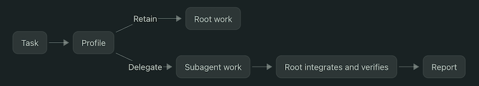

# Polyagent

Polyagent decides which model does each piece of work in a coding agent session. Instead of
explaining it in a prompt, you write a profile: a few small tables that say which model and effort
handles each kind of task at each difficulty. The main agent hands matching work to the subagent
you chose, instead of doing everything on one model in one growing context.



What you get:

- Routing by task type and difficulty. A quick test run and a risky refactor do not have to go to
  the same model.
- Profiles instead of prompts. Plain TSV files, per user or per repository, that you can review and
  share.
- Fallbacks. A band can list several models in order of preference, and the main agent is always
  the last resort.
- One profile for every host. The same tables work across supported hosts, and another host is a
  few more rows.
- Cross-vendor callouts. If you turn them on, a session can hand work to another host's models.
- Subagent reuse. A follow-up task goes back to the idle subagent that already has the context
  instead of starting a new one. You can turn this off.
- An optional directive, such as "keep quick tasks, and tasks that depend on this conversation, at
  root", for work the main agent should not bother delegating.
- No silent decisions. Before each delegation the agent prints what it picked and why:

  ```text
  software.default → Implement native routing
  → risk: 7 complexity: 9 ambiguity: 4
  → implement: change • route: construction
  → band: 9 • gpt-6.2-astra: low • skills: none
  ```

Polyagent is a plain skill. It runs wherever your host runs, from the terminal or the desktop app.

## Installation

Supported hosts: **Codex** (`codex`), **Claude Code** (`claude`), and **Antigravity**
(`antigravity`).

The easy way is to point your agent at this repository and ask it to install Polyagent. To do it
by hand:

**Codex** (invoke with `$polyagent:polyagent`):

```sh
codex plugin marketplace add ohmgh/polyagent --ref marketplace
codex plugin add polyagent@polyagent
```

**Claude Code** (invoke with `/polyagent:polyagent`):

```sh
claude plugin marketplace add ohmgh/polyagent#marketplace
claude plugin install polyagent@polyagent
```

**Antigravity** (invoke with `/polyagent`; requires `agy`, or copy `plugins/polyagent` into
`~/.gemini/config/plugins/polyagent`):

```sh
git clone --branch marketplace --depth 1 https://github.com/ohmgh/polyagent.git /tmp/polyagent
agy plugin install /tmp/polyagent/plugins/polyagent
```

Start a new session afterwards so the skill is picked up.

## Usage

Once installed, routing applies on its own as you work. You can also invoke the skill directly
using your host's skill syntax, for example:

```text
$polyagent:polyagent --profile software.default review the configuration parsing
```

`--profile` picks a profile for this chat without changing your saved default. Leave it out to use
the default, or pass `--profile off` to turn routing off and get the host's normal behaviour back.
The request after it is optional.

The profile is loaded once and reused for the rest of the chat. It is reloaded when you invoke the
skill again or the work moves to another repository, so that is how you pick up an edited profile.

Asking for a subagent outright always gets the task considered for delegation, even if the profile
would normally keep it with the main agent.

## Configuration

Everything is configured in `.tsv` files, with one tab between columns.

Two profiles are bundled. `software.default` is the default and routes coding work: reviews,
design, debugging, implementation and test runs. `general.default` is for other knowledge work,
such as research, assessing a document or plan, and long-form writing. Both include model and
effort choices for every supported host.

Out of the box they are cautious. Easy work stays with the main agent, and so does anything that
depends on the conversation so far. Investigation and test runs are handed off earliest, because
they gain most from a separate context. Each band names one model per host, and the main agent is
always the last resort, so a model missing from your plan never stops the work: the main agent does
it instead.

To make your own, copy a bundled profile from the plugin's `skills/polyagent/profiles` directory to
`~/.polyagent/profiles/CUSTOM_NAME` and edit the copy, or ask your agent to copy it for you. A
profile for one repository goes in `<repo>/.polyagent/profiles`. When names collide the
repository's profile wins, then yours, then the bundled one.

Bundled profiles are replaced when Polyagent updates, so changes go in a profile of your own.

The default profile is set in `~/.polyagent/config.tsv`, or in `<repo>/.polyagent/config.tsv` for
one repository. The repository file wins when it exists, and a malformed one is reported as an
error.

| key | value |
|---|---|
| default_profile | The profile loaded when `--profile` is omitted, or `off` to disable routing. |

```tsv
key	value
default_profile	team.custom
```

A profile is a directory of three tables. The examples below show a few rows each, not complete
files.

### Profile options

`profile.tsv` holds the settings for the profile as a whole.

| key | value |
|---|---|
| directive | A sentence telling the main agent which work to keep for itself, or `-` for none. Ignored when you ask for delegation explicitly. |
| callouts | Other host names whose models this session may hand work to, comma-separated without spaces, or `-` for none. |
| reuse_agents | `on`, the default, lets a follow-up task go back to an idle subagent that already has the context. `off` starts a new subagent each time. |

```tsv
key	value
directive	keep quick tasks, and tasks that depend on this conversation, at root
callouts	-
reuse_agents	on
```

With `reuse_agents` on, a subagent is reused only when the new task continues what it was just
doing and would be routed to the same model and effort anyway. Work that needs a fresh pair of
eyes, such as an independent review, still gets a new subagent.

### Task map

`tasks.tsv` lists the kinds of task you want routed.

| Column | Accepts |
|---|---|
| action | A verb for the activity. |
| deliverable | The kind of output expected. |
| route | The routing group in `routes.tsv` to use, or `-` to keep this kind of task with the main agent. |
| description | A short statement of scope. |
| skills | Skills the task must load, in order, comma-separated without spaces, or `-` for none. |

`action`, `deliverable` and `route` use lowercase letters and digits, with single hyphens between
words, as in `root-cause`.

```tsv
action	deliverable	route	description	skills
review	assessment	judgment	Assess code, design or plan for defects and risks.	-
design	plan	judgment	Propose an implementation or test plan.	-
diagnose	root-cause	investigation	Find the root cause of software behavior.	-
implement	tests	construction	Change automated test definitions.	-
execute	test-results	procedure	Run an existing test suite.	-
```

The main agent matches each piece of work against these rows. If exactly one row fits, its route
applies. If none fits, or more than one does, the main agent does the work itself, so keep the
rows distinct.

### Model routes

`routes.tsv` says which model and effort handles each routing group at each difficulty, host by
host.

| Column | Accepts |
|---|---|
| host | A supported host name (see [Installation](#installation)). |
| route | A routing group named in `tasks.tsv`. |
| difficulty | The upper bound of a difficulty band, from `1` to `10`. Each host's group must end at `10`. |
| model | A model of that host, as its subagent interface names it (without the effort suffix where a host combines them), or `-` for the main agent. |
| effort | The model's reasoning effort, or `-` with a `-` model. |

The main agent grades each task from 1 to 10 for risk, complexity and ambiguity, and the highest
of the three is the difficulty. It takes the first band at or above that difficulty for its own
host.

```tsv
host	route	difficulty	model	effort
codex	construction	4	-	-
codex	construction	6	gpt-6.2-sol	low
codex	construction	8	gpt-6.2-sol	medium
codex	construction	9	gpt-6.2-astra	low
codex	construction	10	gpt-6.2-astra	medium
claude	construction	4	-	-
claude	construction	6	sonnet	medium
claude	construction	8	sonnet	high
claude	construction	9	opus	high
claude	construction	10	opus	xhigh
```

Several rows with the same host, group and difficulty are one band, tried from top to bottom, and
the first model the session can use wins. A `-` row means the main agent and ends the band. Group
the rows by host so each host's table reads on its own. Out of the box each host uses only its own
rows, so one file serves every host:

| Difficulty | In Codex | In Claude Code |
|---|---|---|
| 1 to 4 | The main agent | The main agent |
| 5 to 6 | `gpt-6.2-sol:low` | `sonnet:medium` |
| 7 to 8 | `gpt-6.2-sol:medium` | `sonnet:high` |
| 9 | `gpt-6.2-astra:low`, then the main agent | `opus:high`, then the main agent |
| 10 | `gpt-6.2-astra:medium`, then the main agent | `opus:xhigh`, then the main agent |

Name another host in `callouts`, as in `callouts	claude` in a Codex profile, and that host's rows
for the same band follow your own. The work then leaves your host and runs on the other vendor's
model:

| Difficulty | In Codex with `callouts	claude` | In Claude Code with `callouts	codex` |
|---|---|---|
| 1 to 4 | The main agent | The main agent |
| 5 to 6 | `gpt-6.2-sol:low`, then Claude's `sonnet:medium` | `sonnet:medium`, then Codex's `gpt-6.2-sol:low` |
| 7 to 8 | `gpt-6.2-sol:medium`, then Claude's `sonnet:high` | `sonnet:high`, then Codex's `gpt-6.2-sol:medium` |
| 9 | `gpt-6.2-astra:low`, then Claude's `opus:high`, then the main agent | `opus:high`, then Codex's `gpt-6.2-astra:low`, then the main agent |
| 10 | `gpt-6.2-astra:medium`, then Claude's `opus:xhigh`, then the main agent | `opus:xhigh`, then Codex's `gpt-6.2-astra:medium`, then the main agent |

Bands the main agent keeps for itself stay with it; callouts only extend bands that already name a
model. The bundled profiles name no callouts, so they stay within one host until you opt in. Naming
a host only permits the callout. Polyagent does not install or sign in to the other tool, so you
need a working CLI or runner for it from your session.

Once a subagent has been started, Polyagent does not retry or reroute on its own if it fails. The
main agent tells you what happened and you decide what to do next.

## Building

To build Polyagent yourself or contribute, see [BUILD](BUILD.md).
